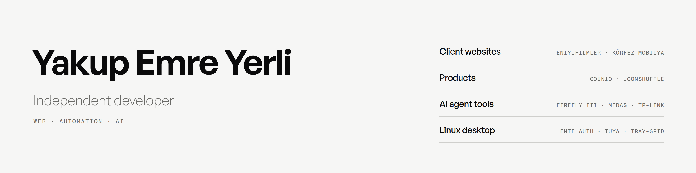

<picture>
  <source media="(prefers-color-scheme: dark)" srcset="assets/banner-dark.png">
  
</picture>

Independent developer from Türkiye. I build websites and web apps for businesses, my own open-source products, and command-line and MCP tools that connect AI agents to real services.

## Client work

- **[eniyifilmler.com](https://eniyifilmler.com)**: Turkish film discovery site. It helps you pick what to watch and shows where a film streams in Turkey.
- **[korfezhalimobilya.com.tr](https://www.korfezhalimobilya.com.tr/)**: site of a furniture and appliance dealer in İzmit with several stores: product catalogue, stores and deals in one place.
- **[halitucar.com.tr](https://www.halitucar.com.tr/)**: news-style personal site for an industrialist and writer, rebuilt from scratch.
- **[artvinbali.com](https://www.artvinbali.com)**: online honey shop, from design to launch.

More on [yakupemreyerli.com](https://yakupemreyerli.com/projects/).

## Open source

- **[IconShuffle](https://github.com/YakupEmreYerli/IconShuffle)**: rearrange an iPhone home screen from your computer, on Windows, macOS or Linux. Drag your real icons in a mirror of the phone or tell your AI agent what you want; every write is backed up, read back and rolled back if it doesn't match. [iconshuffle.app](https://iconshuffle.app)
- **[Coinio](https://github.com/getcoinio/coinio)**: self-hosted subscription and bill tracker in one Docker container. Family plans, reminders by email, Telegram, Discord and more, a built-in MCP server, Firefly III sync, an iPhone widget and eight languages. [getcoinio.me](https://getcoinio.me)
- **[mcp-firefly-iii](https://github.com/YakupEmreYerli/mcp-firefly-iii)**: security-first, self-hosted MCP server and CLI for Firefly III. 152 operations behind 5 scoped tools or the `firefly-cli` command, stdio and authenticated HTTP. Listed in the official Firefly III docs.
- **[mcp-midas](https://github.com/YakupEmreYerli/mcp-midas)**: unofficial MCP server and command-line tool for Midas Atlas. Reads portfolio, transaction history and technicals; order tools are off by default and every order needs desktop approval.
- **[tplink-modem](https://github.com/YakupEmreYerli/tplink-modem)**: command line and MCP server for TP-Link routers and ISP modems: devices, Wi-Fi, logs, fixed IPs and every web-panel setting, each change previewed first. Supports older ISP firmwares such as Türk Telekom's Archer C5v; on PyPI.
- **[ente-auth-plasmoid](https://github.com/YakupEmreYerli/ente-auth-plasmoid)**: Ente Auth two-factor codes in the KDE Plasma panel. Search, click to copy, synced with Ente; encrypted on disk and kept out of clipboard history. Rust core.
- **[tuya-light](https://github.com/YakupEmreYerli/tuya-light)**: controls Tuya Wi-Fi bulbs over the local network, no cloud round trip: a Plasma 6 panel widget with a colour wheel and scenes, a command line, and an MCP server for AI assistants.
- **[tray-grid](https://github.com/YakupEmreYerli/tray-grid)**: Windows-style hidden tray icon grid for KDE Plasma 6. Talks to tray apps over D-Bus like Plasma's own tray, so Electron, Qt and GTK apps all show up and update live.
- **[headmap](https://github.com/YakupEmreYerli/headmap)**: browser extension that shows the title, meta tags and H1–H6 outline of any page at a glance, warns about missing or skipped headings and copies it all as a table.

Smaller pieces: [kde-agents-usage](https://github.com/YakupEmreYerli/kde-agents-usage) (Claude, Codex and Grok usage limits in the Plasma panel), and the matching login and lock screen themes [yakupemre-sddm](https://github.com/YakupEmreYerli/yakupemre-sddm) and [yakupemre-lockscreen](https://github.com/YakupEmreYerli/yakupemre-lockscreen).

## Open-source contributions

- **[vrtmrz/obsidian-livesync](https://github.com/vrtmrz/obsidian-livesync)**: fix and regression tests for a startup scan that could delete records from CouchDB in the CLI daemon ([#1188](https://github.com/vrtmrz/obsidian-livesync/pull/1188)). Adapted and released in 1.0.29 ([#1191](https://github.com/vrtmrz/obsidian-livesync/pull/1191), [#1192](https://github.com/vrtmrz/obsidian-livesync/pull/1192)).
- **[saidsurucu/borsa-mcp](https://github.com/saidsurucu/borsa-mcp)**: adapted the Mynet stock list parser to the site's new layout; while it was broken, KAP news lookups quietly came back empty ([#18](https://github.com/saidsurucu/borsa-mcp/pull/18)).
- **[firefly-iii/docs](https://github.com/firefly-iii/docs)**: added the Firefly III MCP server to the official list of third-party apps, then kept the entry accurate as the server changed ([#259](https://github.com/firefly-iii/docs/pull/259), [#260](https://github.com/firefly-iii/docs/pull/260)).
- **[punkpeye/awesome-mcp-servers](https://github.com/punkpeye/awesome-mcp-servers)**: added the Firefly III MCP server to the Finance & Fintech list ([#13247](https://github.com/punkpeye/awesome-mcp-servers/pull/13247)).

## Activity

<picture>
  <source media="(prefers-color-scheme: dark)" srcset="activity/dark.svg">
  
</picture>

## Türkçe

Türkiye'den bağımsız geliştiriciyim. İşletmeler için web siteleri ve web uygulamaları, kendi açık kaynak ürünlerimi ve yapay zekâ ajanlarını gerçek servislere bağlayan komut satırı ve MCP araçları geliştiriyorum.

[yakupemreyerli.com](https://yakupemreyerli.com) · [LinkedIn](https://www.linkedin.com/in/yakupemreyerli/)
